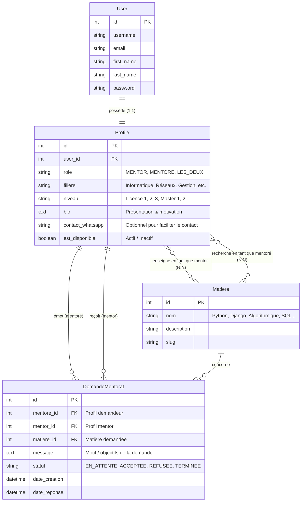
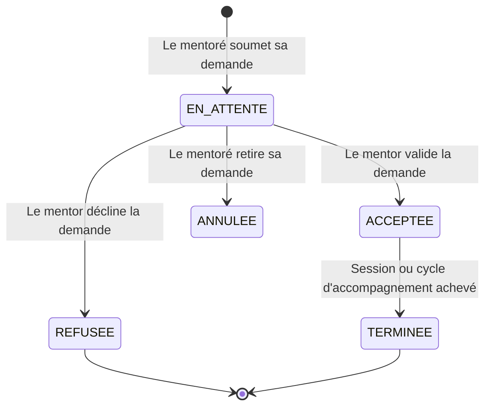

# 📐 Conception Technique & Modélisation — Force Mentor

---

## 1. Architecture Globale (Pattern MVT de Django)

L'application suit le pattern architectural standard de Django : **Modèle - Template - Vue (MTV)** :
* **Modèles (`models.py`)** : Définition des structures de données et de la logique métier, interfacés avec SQLite via l'ORM Django.
* **Vues (`views.py`)** : Logique de traitement des requêtes HTTP, contrôle d'accès (utilisateurs connectés), filtrage des données et rendu.
* **Gabarits / Templates (`*.html`)** : Interface utilisateur en HTML5/CSS3 natif, utilisant le moteur de gabarits de Django sans dépendance JavaScript superflue.

---

## 2. Modèle de Données & Schéma Relationnel

---

## 3. Cycle de Vie d'une Demande de Mentorat

---

## 4. Découpage en Applications Django

Pour garder le code modulaire, maintenable et conforme aux bonnes pratiques Django :

1. **`accounts`** :
   * Inscription, connexion, déconnexion.
   * Modèle étendu `Profile` avec signaux (`post_save`) pour création automatique.
   * Édition du profil (rôle, filière, niveau, biographie).
2. **`mentorship`** :
   * Modèles `Matiere` et `DemandeMentorat`.
   * Consultation de l'annuaire des mentors.
   * Filtre rapide par matière (< 3 clics).
   * Envoi d'une demande de mentorat.
   * Tableaux de bord personnalisés (Espace Mentoré & Espace Mentor).
   * Actions d'acceptation / refus par le mentor.

---

## 5. Arborescence des URLs (Routes)

| URL | Vue associée | Description |
| :--- | :--- | :--- |
| `/` | `home` | Page d'accueil / présentation du service |
| `/connexion/` | `login_view` | Formulaire d'authentification |
| `/inscription/` | `register_view` | Formulaire de création de compte |
| `/deconnexion/` | `logout_view` | Déconnexion |
| `/profil/` | `profile_view` | Consultation et modification du profil |
| `/mentors/` | `mentor_list` | Annuaire des mentors avec filtre par matière |
| `/mentors/<id>/` | `mentor_detail` | Fiche détaillée d'un mentor et bouton de demande |
| `/demande/creer/<mentor_id>/` | `create_request` | Formulaire d'envoi d'une demande |
| `/tableau-de-bord/` | `dashboard` | Tableau de bord (demandes envoyées & reçues) |
| `/demande/<id>/<action>/` | `handle_request` | Accepter ou refuser une demande reçue |
