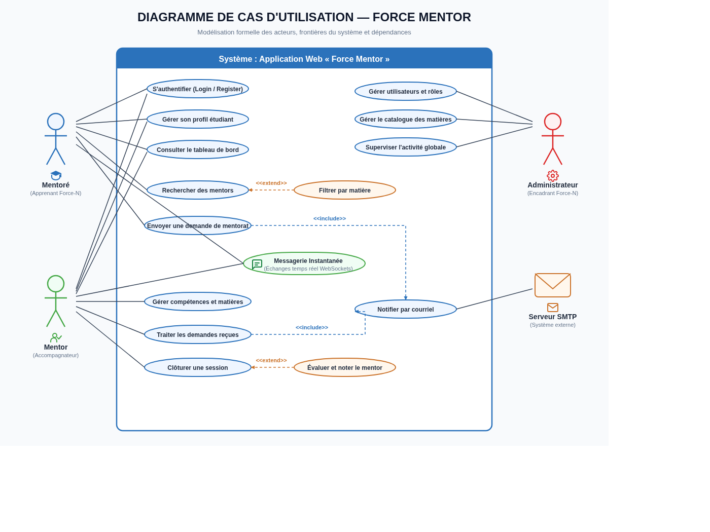
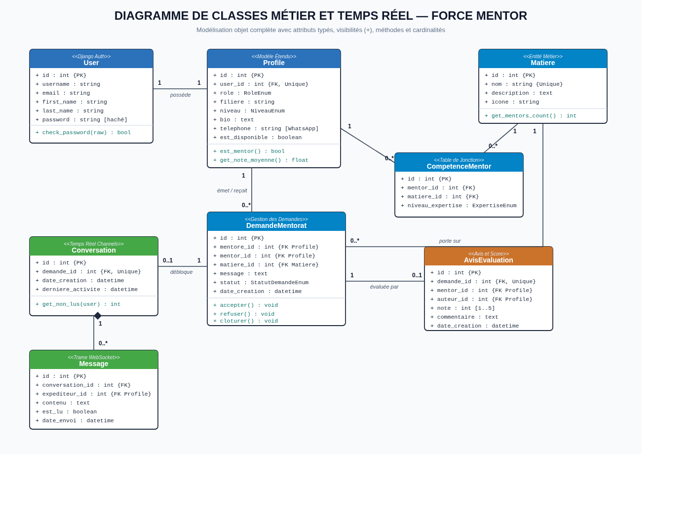
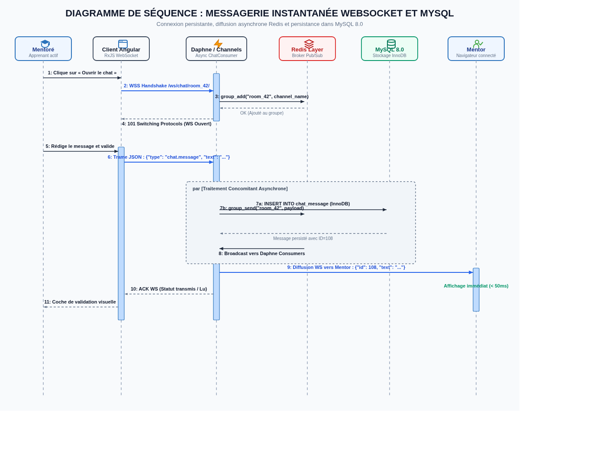
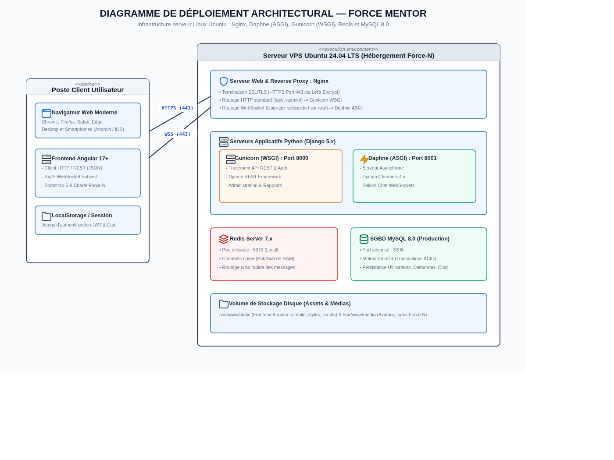

# Schémas & Diagrammes UML — Projet Force Mentor

Ce document présente les **schémas visuels graphiques (PNG/SVG)** et la modélisation formelle de l'application **Force Mentor**.

---

## Visionneuse Web Interactive

Vous pouvez ouvrir directement la page web interactive contenant tous les schémas avec zoom et téléchargement immédiat :
* **[schema_visuel_uml.html](file:///home/joe/Bureau/force-mentor/docs/schema_visuel_uml.html)**

---

## 1. Diagramme de Cas d'Utilisation (Use Case Diagram)

### Spécifications du diagramme :
* **Acteurs :** 
  * `Mentoré` (Apprenant demandeur d'accompagnement)
  * `Mentor` (Apprenant accompagnateur sur une matière)
  * `Administrateur` (Encadrant Force-N)
  * `Serveur SMTP` (Système externe pour les notifications)
* **Relations d'inclusion (`<<include>>`) :** L'émission et le traitement d'une demande incluent systématiquement l'envoi de notification courriel et l'authentification.
* **Relations d'extension (`<<extend>>`) :** Le filtrage par matière étend la recherche ; la notation et l'avis étendent la clôture de la session.
* **Messagerie instantanée :** Intégrée comme cas d'échange interactif en temps réel entre le mentor et le mentoré.

---

## 2. Diagramme de Classes Métier & Temps Réel (Class Diagram)

### Spécifications du diagramme :
* **Boîtes normalisées à 3 compartiments :** Nom de classe, Attributs typés avec visibilité (`+` public) et Méthodes métier.
* **Multiplicités & Associations :**
  * `User` (1) ⟷ (1) `Profile` (profil étudiant étendu Django)
  * `Profile` (1) ⟷ (0..*) `CompetenceMentor` ⟷ (1) `Matiere` (table d'association des compétences)
  * `Profile` (1) ⟷ (0..*) `DemandeMentorat` (liens émetteur/récepteur)
  * `DemandeMentorat` (1) ⟷ (0..1) `Conversation` (générée lors de l'acceptation)
* **Composition forte (Losange plein) :** `Conversation` (1) ◆── (0..*) `Message` (cycle de vie lié).

---

## 3. Diagramme de Séquence : Messagerie Instantanée (Sequence Diagram)

### Spécifications du diagramme :
* **Lignes de vie & activations :** Synchronisation entre le Client Angular, le serveur ASGI Daphne, le broker Redis et MySQL 8.0.
* **Handshake WebSockets :** Négociation de protocole `wss://` vers `/ws/chat/room_42/` et enregistrement dans le groupe Redis.
* **Bloc Parallèle (`par`) :**
  * **Branche A :** Persistance synchrone du message dans la base relationnelle MySQL 8.0 (InnoDB) ;
  * **Branche B :** Diffusion ultra-rapide par le Channel Layer Redis à tous les participants abonnés.
* **Résultat :** Affichage immédiat du message chez le destinataire (< 50 ms) avec accusé de réception à l'expéditeur.

---

## 4. Diagramme de Déploiement Architectural (Deployment Diagram)

### Spécifications du diagramme :
* **Poste Client (`<<device>>`) :** Navigateurs modernes (Desktop / Mobile) exécutant l'application monopage (SPA) Angular 17+.
* **Nœud Serveur de Production (`<<execution environment>>`) :** VPS Ubuntu 24.04 LTS.
  * **Nginx :** Reverse Proxy, terminaison SSL/TLS (Port 443), séparation des flux HTTP (`/api/`) vers Gunicorn et WebSockets (`/ws/`) vers Daphne.
  * **Gunicorn (WSGI - Port 8000) :** Traitement de l'API REST et de l'administration Django.
  * **Daphne (ASGI - Port 8001) :** Gestion asynchrone des sockets persistantes WebSockets.
  * **Redis Server (Port 6379) :** Broker mémoire pour les channels de messagerie.
  * **MySQL 8.0 (Port 3306) :** SGBD relationnel avec moteur transactionnel InnoDB.
* **Services Tiers :** Passerelle SMTP (Port 587 - TLS) pour les courriels.

---

## Ressources Associées

* Images vectorielles et bitmaps : dossier [diagrammes_img](file:///home/joe/Bureau/force-mentor/docs/diagrammes_img)
* Script générateur : [generer_schemas_uml.py](file:///home/joe/Bureau/force-mentor/docs/generer_schemas_uml.py)
* Page interactive : [schema_visuel_uml.html](file:///home/joe/Bureau/force-mentor/docs/schema_visuel_uml.html)
